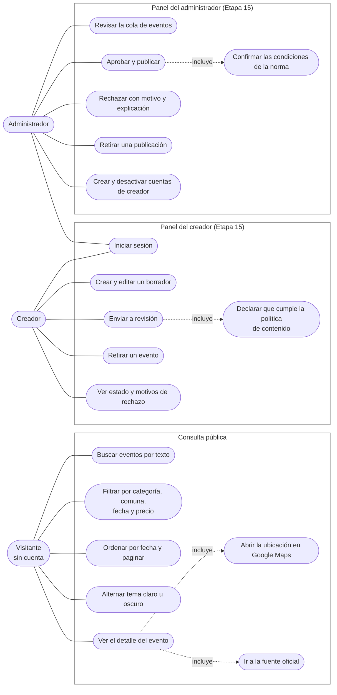
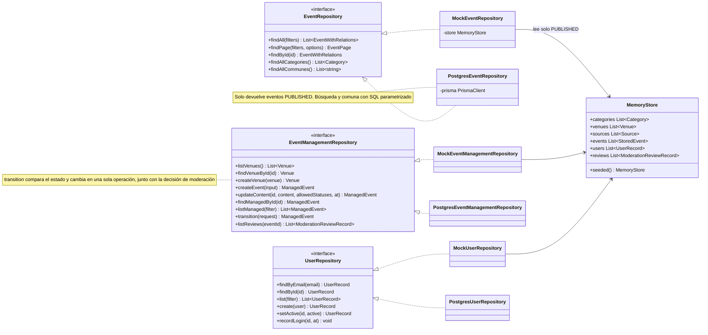
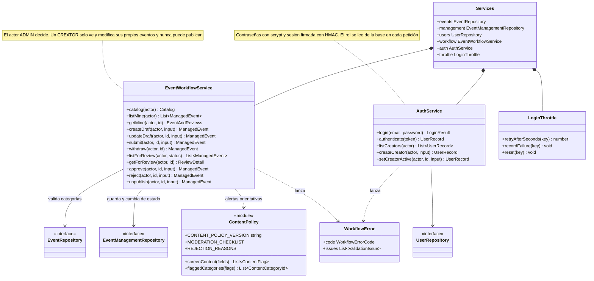
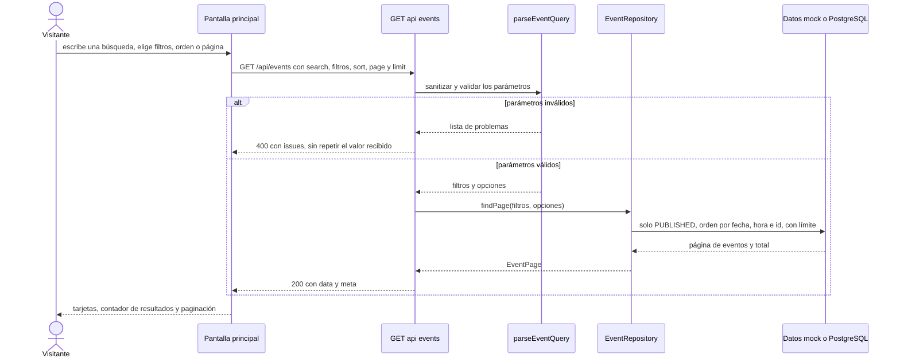
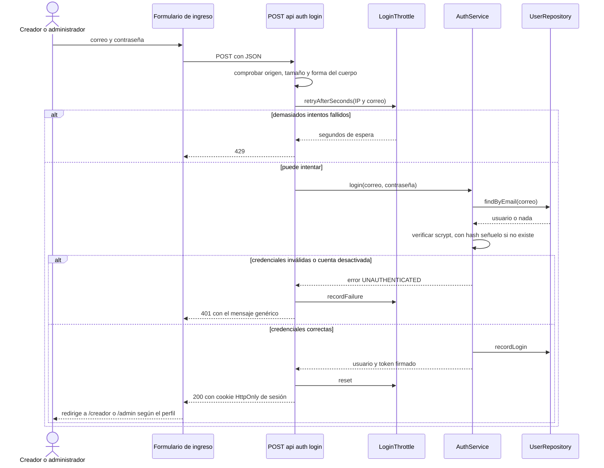
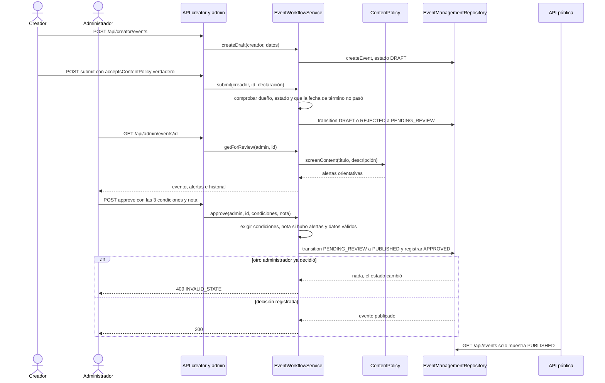

# Diagramas UML — MOZAK (APT)

> **Fuente y vigencia.** Diagramas versionados en git, escritos en **Mermaid** (GitHub los muestra directamente). Los de **clases** y **secuencia** se construyeron a partir del código real (`src/lib/**`, `src/app/api/**`; fecha 24-11-2026), no de un diseño aparte. El diagrama de **casos de uso** amplía el de Drive («Arquitectura del Sistema - MOZAK», 30-10-2026, un solo actor) con los perfiles de la Etapa 15. Los elementos de la **Etapa 15 (creador y administrador) están implementados pero pendientes de verificación** en el equipo del usuario. La arquitectura general, el diagrama de componentes y el proceso BPM siguen en el documento de Drive; el modelo entidad-relación está en [`MODELO-DE-DATOS.md`](MODELO-DE-DATOS.md).

Contenido: 1. casos de uso · 2. clases (acceso a datos) · 3. clases (servicios de la Etapa 15) · 4. secuencia: consulta pública · 5. secuencia: inicio de sesión · 6. secuencia: del borrador a la publicación.

## 1. Casos de uso

El **visitante no tiene cuenta**: solo consulta eventos publicados. Creador y administrador inician sesión. Las líneas punteadas con «incluye» indican que un caso de uso siempre requiere otro.

Notas: ordenar y paginar corresponde a la Etapa 13 (verificada 30-10-2026) y el enlace a Google Maps a la Etapa 14 (verificada 19-11-2026). La condición de la norma que confirma el administrador son tres: sin desnudos ni actos sexuales, sin drogas ni tráfico de drogas, sin mercado negro (política `2026-11-v1`, ver [`ROLES-Y-MODERACION.md`](ROLES-Y-MODERACION.md)).

## 2. Diagrama de clases — acceso a datos

El código de la aplicación (API y páginas) solo conoce las **interfaces** (puertos). Cada una tiene una implementación en memoria (modo `mock`, por defecto) y otra en PostgreSQL con Prisma; una misma batería de contrato las ejecuta a ambas. Desde la Etapa 15, el repositorio mock y la gestión de eventos comparten un `MemoryStore`, de modo que lo que aprueba un administrador aparece en el listado público.

La fuente se elige con `DATA_SOURCE` (`mock` por defecto, `postgres`) en `factory.ts`; el repositorio de PostgreSQL se carga de forma diferida, de modo que el modo mock nunca carga `@prisma/client`.

## 3. Diagrama de clases — servicios de la Etapa 15

`composeServices` arma los servicios a partir de los repositorios sin saber de dónde vienen los datos. Las rutas de `src/app/api/{auth,creator,admin}` son delgadas: delegan en los manejadores (`src/lib/server`), que validan sesión, perfil y origen y llaman a estos servicios.

## 4. Secuencia — consulta pública de eventos

Es el flujo del visitante (sin cuenta). Se verificó en las Etapas 3, 5 y 13; desde la Etapa 15 el repositorio solo devuelve eventos publicados.

## 5. Secuencia — inicio de sesión (Etapa 15)

El mismo mensaje de error se usa para correo inexistente, contraseña incorrecta y cuenta desactivada. Los intentos fallidos se cuentan por IP y correo.

## 6. Secuencia — del borrador a la publicación (Etapa 15)

Muestra el ciclo completo con las garantías del diseño: el creador declara la política, el administrador confirma las tres condiciones, y el cambio de estado y la decisión se guardan de forma atómica.

Variantes: **rechazar** y **retirar la publicación** siguen el mismo patrón (`REJECTED`/`UNPUBLISHED`, con motivo y explicación obligatorios); el creador puede **retirar** su evento (de revisión o publicado) y vuelve a borrador.
