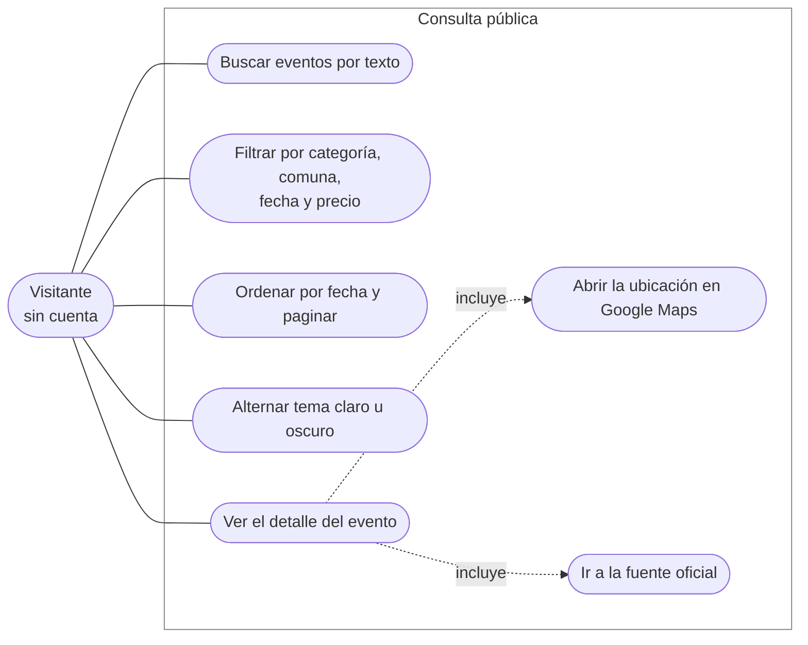
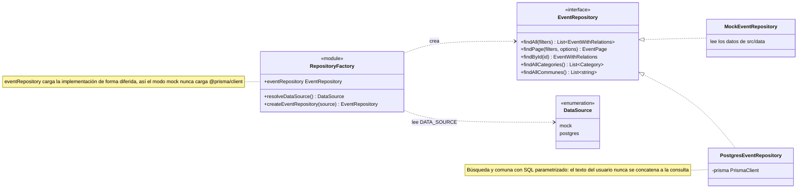
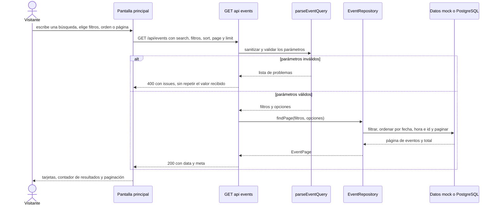
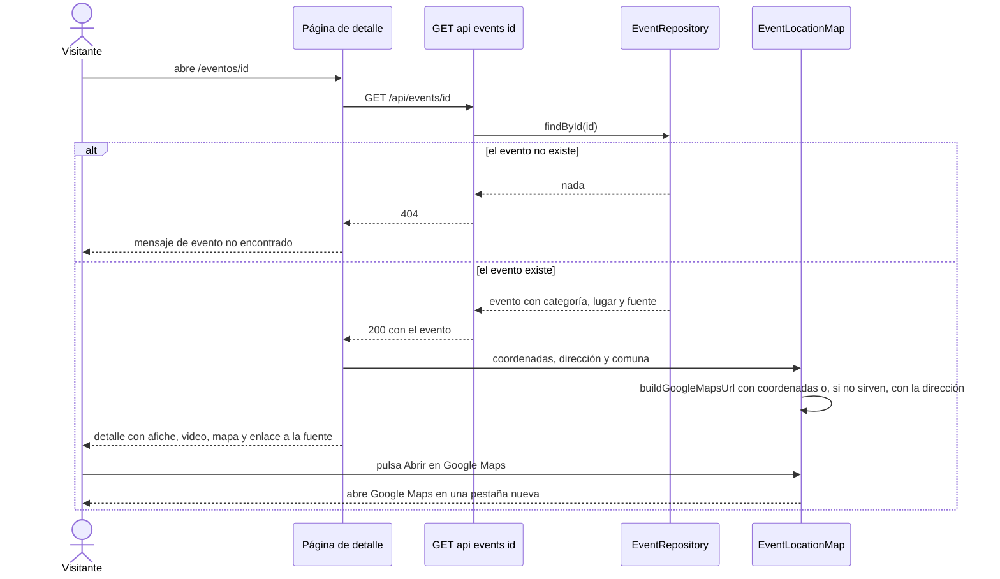

# Diagramas UML — MOZAK (APT)

> **Fuente y vigencia.** Diagramas versionados en git, escritos en **Mermaid** (GitHub los muestra directamente). Los de **clases** y **secuencia** se construyeron a partir del código real de `master` (`src/lib/**`, `src/app/**`; fecha 24-11-2026), no de un diseño aparte. El diagrama de **casos de uso** parte del de Drive («Arquitectura del Sistema - MOZAK», 30-10-2026, un solo actor). La arquitectura general, el diagrama de componentes y el proceso BPM siguen en ese documento de Drive; el modelo entidad-relación está en [`MODELO-DE-DATOS.md`](MODELO-DE-DATOS.md). **Los perfiles de creador y administrador (Etapa 15) no están en `master`:** viven en la rama `feature/roles-moderacion`, pendientes de verificación, y sus diagramas (servicios, inicio de sesión y publicación) se agregan a este documento al integrarla.

Contenido: 1. casos de uso · 2. clases (acceso a datos) · 3. secuencia: consulta pública · 4. secuencia: detalle y ubicación.

## 1. Casos de uso

El **visitante no tiene cuenta**: solo consulta eventos. Las líneas punteadas con «incluye» indican que un caso de uso siempre requiere otro.

Notas: ordenar y paginar corresponde a la Etapa 13 (verificada 30-10-2026) y el enlace a Google Maps a la Etapa 14 (verificada 19-11-2026).

## 2. Diagrama de clases — acceso a datos

El código de la aplicación (API y páginas) solo conoce la **interfaz** `EventRepository` (un *puerto*, en el sentido de la arquitectura hexagonal). Tiene dos implementaciones, una en memoria (modo `mock`, por defecto) y otra en PostgreSQL con Prisma; una misma batería de contrato (`event-repository.contract.ts`) las ejecuta a ambas, de modo que cambiar de fuente no cambia ningún resultado.

La fuente se elige con `DATA_SOURCE` (`mock` por defecto, `postgres`). Con `postgres` es obligatorio definir `DATABASE_URL`; un valor inválido de `DATA_SOURCE` se rechaza con un error explícito.

## 3. Secuencia — consulta pública de eventos

Es el flujo del visitante (sin cuenta). Se verificó en las Etapas 3, 5 y 13.

## 4. Secuencia — detalle del evento y ubicación

La página de detalle consulta la API y arma el enlace a Google Maps con las coordenadas del lugar o, si no sirven, con su dirección (Etapa 14).

