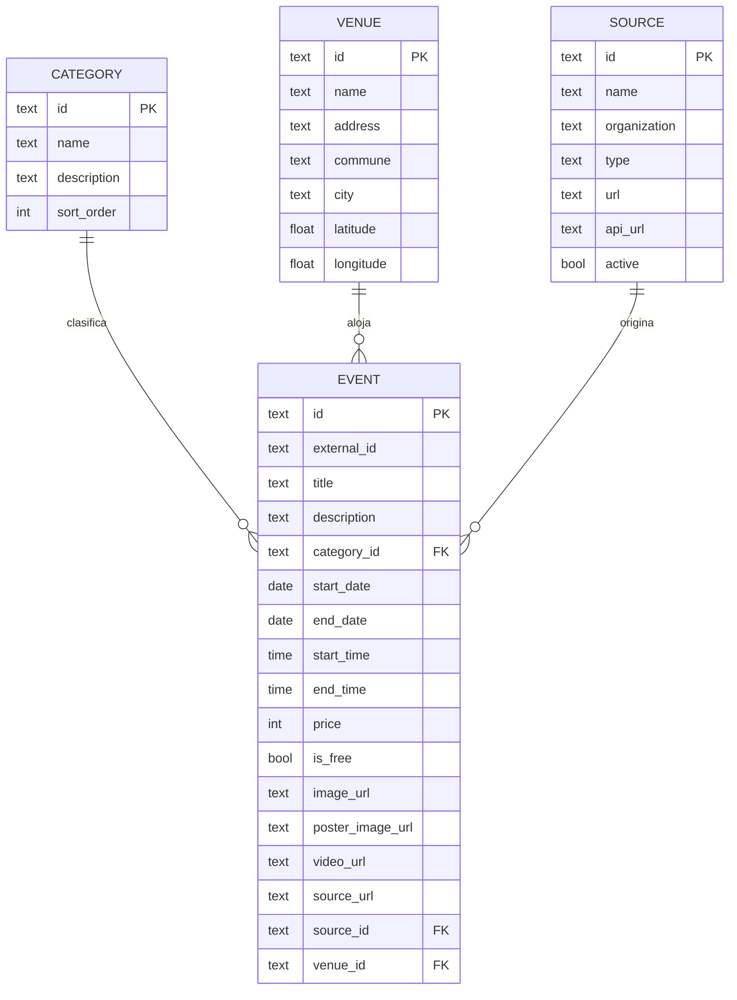

# Modelo de datos — MOZAK (APT)

> **Fuente y vigencia.** Documento versionado en git. Describe el esquema **real** de `prisma/schema.prisma` y de la migración `prisma/migrations/0001_init` tal como están en `master` (24-11-2026). La versión de Drive «Modelo de Datos - MOZAK» (30-10-2026) describe las mismas 4 entidades; este archivo la amplía con el diagrama entidad-relación, las restricciones y los índices. **La migración 0001 está verificada** (Etapa 11, 26-10-2026; `npm run test:db` 33/33 y luego 60/60 el 30-10-2026). La Etapa 15 agrega usuarios, estado del evento y moderación con una segunda migración (`0002_roles_moderacion`) que **vive en la rama `feature/roles-moderacion`, no está en `master` y no está verificada**; su modelo se documenta junto con ella.

## 1. Diagrama entidad-relación

El diagrama muestra las entidades y sus claves foráneas. Los tipos son los de PostgreSQL; `PK` = clave primaria, `FK` = clave foránea. Se ve directamente en GitHub (Mermaid).

**Lectura del diagrama**

- Un **evento** pertenece a una categoría, a un lugar (venue) y a una fuente (source). Las tres relaciones son 1:N con borrado restringido (`ON DELETE RESTRICT`): no se puede borrar una categoría, un lugar o una fuente que tenga eventos.
- El **visitante no tiene cuenta**, por eso no hay tabla de usuarios en `master`.

## 2. Modelo lógico

### category
| Columna | Tipo | Restricción |
|---------|------|-------------|
| id | text | PK |
| name | text | NOT NULL |
| description | text | NOT NULL |
| sort_order | integer | NOT NULL, por defecto 0 (orden de presentación en el filtro) |

### venue
| Columna | Tipo | Restricción |
|---------|------|-------------|
| id | text | PK |
| name, address, commune, city | text | NOT NULL |
| latitude | double precision | NOT NULL, entre -90 y 90 (`venue_latitude_chk`) |
| longitude | double precision | NOT NULL, entre -180 y 180 (`venue_longitude_chk`) |

### source
| Columna | Tipo | Restricción |
|---------|------|-------------|
| id | text | PK |
| name, organization, type | text | NOT NULL |
| url | text | NOT NULL, URL válida (la valida Zod) |
| api_url | text | URL válida o NULL |
| active | boolean | NOT NULL, por defecto true |

### event
| Columna | Tipo | Restricción |
|---------|------|-------------|
| id | text | PK |
| external_id | text | NULL permitido |
| title, description | text | NOT NULL |
| category_id | text | NOT NULL, FK → category.id |
| start_date, end_date | date | NOT NULL; `end_date ≥ start_date` (`event_dates_chk`) |
| start_time, end_time | time(0) | NOT NULL |
| price | integer | NOT NULL, pesos chilenos (CLP) sin decimales |
| is_free | boolean | NOT NULL; si es true, `price = 0`; si es false, `price > 0` (`event_price_chk`) |
| image_url | text | URL válida o NULL |
| poster_image_url, video_url | text | Ruta local (`/…`) o URL http(s), o NULL (`event_poster_chk`, `event_video_chk`) |
| source_url | text | NOT NULL, URL válida |
| source_id | text | NOT NULL, FK → source.id |
| venue_id | text | NOT NULL, FK → venue.id |

## 3. Índices

| Índice | Columnas | Motivo |
|--------|----------|--------|
| `event_category_idx`, `event_venue_idx`, `event_source_idx` | category_id, venue_id, source_id | Claves foráneas |
| `event_dates_idx` | start_date, end_date | Filtro por fecha |

No se agregó un índice para el orden `(start_date, start_time, id)`: con 24 eventos de demostración no hace falta; conviene evaluarlo cuando la ingesta (HU-24) haga crecer la tabla.

## 4. Reglas de negocio validadas dos veces

Las reglas (`is_free ↔ price`, `end_date ≥ start_date`, formato de afiche y video, rangos de latitud y longitud) se validan **en el código** (Zod, `src/lib/schemas.ts`) **y como restricciones CHECK en la base**. Así, ni un error del código ni una carga directa a la base pueden dejar datos inválidos (MTC_00260). Prisma no modela las extensiones ni los CHECK: viven solo en el SQL de la migración.

## 5. Extensiones y migraciones

| Migración | Contenido | Estado |
|-----------|-----------|--------|
| `0001_init` | Extensiones `postgis` y `unaccent`; tablas `category`, `venue`, `source`, `event` con sus restricciones e índices | Verificada (26-10-2026) |
| `0002_roles_moderacion` | Enumerados, tabla de usuarios, estado y autor del evento, historial de moderación | En la rama `feature/roles-moderacion` (Etapa 15); **no integrada a `master` y pendiente de verificación** |

- `unaccent` permite buscar sin distinguir tildes («nunoa» encuentra «Ñuñoa»); PostGIS está habilitado desde la Etapa 11.
- **Planificado (aún no aplicado):** la columna geográfica `venue.location geography(Point, 4326)` con índice GiST para la búsqueda por proximidad (HU-25, Sprint 5). En Prisma se declararía con `Unsupported("geography(Point, 4326)")`.
- Las migraciones se escriben a mano y se aplican con `prisma migrate deploy` (`npm run db:migrate`). La semilla (`prisma/seed.ts`) valida cada registro con Zod y usa `upsert`, por lo que puede repetirse sin duplicar filas.

## 6. Diferencias respecto del diseño original (Etapa 11)

| Tema | Diseño original | Implementado |
|------|-----------------|--------------|
| Coordenadas | numeric(9,6) | double precision, con las mismas restricciones de rango |
| Precio | numeric(10,0) | integer (CLP sin decimales) |
| Orden de categorías | No existía | `category.sort_order` |
| Búsqueda sin tildes | No prevista | Extensión `unaccent` |
| `venue.location` | En el DDL inicial | Aplazada a HU-25 (Sprint 5) |
