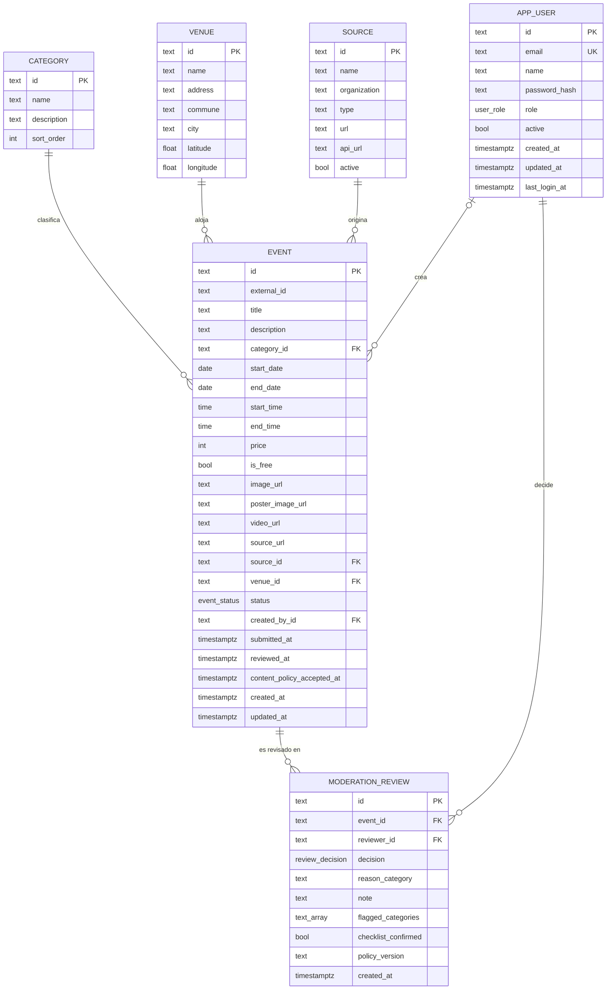

# Modelo de datos — MOZAK (APT)

> **Fuente y vigencia.** Documento versionado en git. Describe el esquema **real** de `prisma/schema.prisma` y de las migraciones `prisma/migrations/0001_init` y `0002_roles_moderacion` (fecha de este documento: 24-11-2026). La versión de Drive «Modelo de Datos - MOZAK» (30-10-2026) describe las 4 entidades de la Etapa 11; este archivo la amplía con el diagrama entidad-relación y con las entidades de la Etapa 15. **La migración 0001 está verificada (Etapa 11, 26-10-2026; `npm run test:db` 33/33 y luego 60/60 el 30-10-2026). La migración 0002 todavía NO se ha aplicado ni verificado en el equipo del usuario** (solo se probó a mano en PostgreSQL 16 sin PostGIS).

## 1. Diagrama entidad-relación

El diagrama muestra las entidades y sus claves foráneas. Los tipos son los de PostgreSQL; `PK` = clave primaria, `FK` = clave foránea, `UK` = única. Se ve directamente en GitHub (Mermaid).

**Lectura del diagrama**

- Un **evento** pertenece a una categoría, a un lugar (venue) y a una fuente (source). Las tres relaciones son 1:N con borrado restringido (`ON DELETE RESTRICT`).
- Un evento puede tener **creador** (`created_by_id`, opcional): los eventos de demostración cargados por la semilla no tienen creador (`NULL`). Si se borra el usuario, el evento se conserva (`ON DELETE SET NULL`).
- Cada decisión de un administrador queda en **moderation_review**, ligada al evento (se borra con el evento, `CASCADE`) y al revisor (no se puede borrar un usuario con decisiones, `RESTRICT`).
- El **consumidor no tiene cuenta**: `app_user` solo contiene administradores y creadores.

## 2. Tipos enumerados (Etapa 15)

| Tipo | Valores | Uso |
|------|---------|-----|
| `user_role` | `ADMIN`, `CREATOR` | Perfil de la cuenta |
| `event_status` | `DRAFT`, `PENDING_REVIEW`, `PUBLISHED`, `REJECTED` | Ciclo de vida del evento; solo `PUBLISHED` es visible en la API pública |
| `review_decision` | `APPROVED`, `REJECTED`, `UNPUBLISHED` | Resultado de una decisión de moderación |

## 3. Modelo lógico

### category
| Columna | Tipo | Restricción |
|---------|------|-------------|
| id | text | PK |
| name | text | NOT NULL |
| description | text | NOT NULL |
| sort_order | integer | NOT NULL, por defecto 0 (orden de presentación en el filtro) |

### venue
| Columna | Tipo | Restricción |
|---------|------|-------------|
| id | text | PK |
| name, address, commune, city | text | NOT NULL |
| latitude | double precision | NOT NULL, entre -90 y 90 (`venue_latitude_chk`) |
| longitude | double precision | NOT NULL, entre -180 y 180 (`venue_longitude_chk`) |

### source
| Columna | Tipo | Restricción |
|---------|------|-------------|
| id | text | PK |
| name, organization, type | text | NOT NULL |
| url | text | NOT NULL, URL válida (la valida Zod) |
| api_url | text | URL válida o NULL |
| active | boolean | NOT NULL, por defecto true |

### app_user *(Etapa 15)*
| Columna | Tipo | Restricción |
|---------|------|-------------|
| id | text | PK |
| email | text | NOT NULL, único, siempre en minúsculas (`app_user_email_lower_chk`) |
| name | text | NOT NULL |
| password_hash | text | NOT NULL; hash scrypt con sal (nunca la contraseña) |
| role | user_role | NOT NULL |
| active | boolean | NOT NULL, por defecto true |
| created_at, updated_at | timestamptz(3) | NOT NULL, por defecto la fecha actual |
| last_login_at | timestamptz(3) | NULL hasta el primer ingreso |

La tabla se llama `app_user` porque `user` es palabra reservada en PostgreSQL.

### event
| Columna | Tipo | Restricción |
|---------|------|-------------|
| id | text | PK |
| external_id | text | NULL permitido |
| title, description | text | NOT NULL |
| category_id | text | NOT NULL, FK → category.id |
| start_date, end_date | date | NOT NULL; `end_date ≥ start_date` (`event_dates_chk`) |
| start_time, end_time | time(0) | NOT NULL |
| price | integer | NOT NULL, pesos chilenos (CLP) sin decimales |
| is_free | boolean | NOT NULL; si es true, `price = 0`; si es false, `price > 0` (`event_price_chk`) |
| image_url | text | URL válida o NULL |
| poster_image_url, video_url | text | Ruta local (`/…`) o URL http(s), o NULL (`event_poster_chk`, `event_video_chk`) |
| source_url | text | NOT NULL, URL válida |
| source_id | text | NOT NULL, FK → source.id |
| venue_id | text | NOT NULL, FK → venue.id |
| **status** *(E15)* | event_status | NOT NULL, por defecto `DRAFT` (los eventos existentes al migrar quedaron `PUBLISHED`) |
| **created_by_id** *(E15)* | text | FK → app_user.id, NULL en eventos de demostración |
| **submitted_at**, **reviewed_at**, **content_policy_accepted_at** *(E15)* | timestamptz(3) | NULL hasta que ocurre cada paso del flujo |
| **created_at**, **updated_at** *(E15)* | timestamptz(3) | NOT NULL |
| restricción `event_published_reviewed_chk` *(E15)* | | Un evento de un creador no puede estar `PUBLISHED` sin `reviewed_at` |

### moderation_review *(Etapa 15)*
| Columna | Tipo | Restricción |
|---------|------|-------------|
| id | text | PK |
| event_id | text | NOT NULL, FK → event.id, `ON DELETE CASCADE` |
| reviewer_id | text | NOT NULL, FK → app_user.id, `ON DELETE RESTRICT` |
| decision | review_decision | NOT NULL |
| reason_category | text | NULL al aprobar; si no, uno de `ADULT_CONTENT`, `DRUGS`, `BLACK_MARKET`, `OTHER_NORM`, `INCOMPLETE_INFO` |
| note | text | Explicación del administrador (obligatoria al rechazar o retirar y, al aprobar, si hubo alertas automáticas) |
| flagged_categories | text[] | Categorías que marcó la revisión automática al decidir (por defecto vacío) |
| checklist_confirmed | boolean | NOT NULL; una aprobación exige `true` (`moderation_review_approved_chk`) |
| policy_version | text | NOT NULL, versión de la política de contenido vigente (hoy `2026-11-v1`) |
| created_at | timestamptz(3) | NOT NULL |

Solo se agregan filas (auditoría): el código no edita ni borra decisiones.

## 4. Índices

| Índice | Columnas | Motivo |
|--------|----------|--------|
| `event_category_idx`, `event_venue_idx`, `event_source_idx` | category_id, venue_id, source_id | Claves foráneas |
| `event_dates_idx` | start_date, end_date | Filtro por fecha |
| `event_status_idx` *(E15)* | status | La API pública filtra por `PUBLISHED`; el administrador filtra por estado |
| `event_created_by_idx` *(E15)* | created_by_id | «Mis eventos» del creador |
| `moderation_review_event_idx`, `moderation_review_reviewer_idx` *(E15)* | event_id, reviewer_id | Historial por evento y por revisor |
| `app_user_email_key` *(E15)* | email | Único; búsqueda por correo al ingresar |

No se agregó un índice para el orden `(start_date, start_time, id)`: con 24 eventos de demostración no hace falta; conviene evaluarlo cuando la ingesta (HU-24) haga crecer la tabla.

## 5. Reglas de negocio validadas dos veces

Las reglas (`is_free ↔ price`, `end_date ≥ start_date`, formato de afiche y video, rangos de latitud y longitud, correo en minúsculas, evento de creador publicado solo con revisión, aprobación solo con lista confirmada) se validan **en el código** (Zod, `src/lib/schemas.ts` y `src/lib/moderation/schemas.ts`) **y como restricciones CHECK en la base**. Así, ni un error del código ni una carga directa a la base pueden dejar datos inválidos (MTC_00260). Prisma no modela las extensiones ni los CHECK: viven solo en el SQL de las migraciones.

## 6. Extensiones y migraciones

| Migración | Contenido | Estado |
|-----------|-----------|--------|
| `0001_init` | Extensiones `postgis` y `unaccent`; tablas `category`, `venue`, `source`, `event` con sus restricciones e índices | Verificada (26-10-2026) |
| `0002_roles_moderacion` | Enumerados, tabla `app_user`, columnas de estado y autor en `event`, tabla `moderation_review`, restricciones e índices | **Pendiente de verificación** (`npm run db:migrate` y `npm run test:db` en el equipo del usuario) |

- `unaccent` permite buscar sin distinguir tildes («nunoa» encuentra «Ñuñoa»); PostGIS está habilitado desde la Etapa 11.
- **Planificado (aún no aplicado):** la columna geográfica `venue.location geography(Point, 4326)` con índice GiST para la búsqueda por proximidad (HU-25, Sprint 5). En Prisma se declararía con `Unsupported("geography(Point, 4326)")`.
- Las migraciones se escriben a mano y se aplican con `prisma migrate deploy` (`npm run db:migrate`). La semilla (`prisma/seed.ts`) valida cada registro con Zod y usa `upsert`, por lo que puede repetirse sin duplicar filas; crea el administrador solo si se definen `SEED_ADMIN_EMAIL` y `SEED_ADMIN_PASSWORD`.

## 7. Diferencias respecto del diseño original (Etapa 11)

| Tema | Diseño original | Implementado |
|------|-----------------|--------------|
| Coordenadas | numeric(9,6) | double precision, con las mismas restricciones de rango |
| Precio | numeric(10,0) | integer (CLP sin decimales) |
| Orden de categorías | No existía | `category.sort_order` |
| Búsqueda sin tildes | No prevista | Extensión `unaccent` |
| `venue.location` | En el DDL inicial | Aplazada a HU-25 (Sprint 5) |
| Usuarios, estado y moderación | No existían (alcance «sin cuentas») | Etapa 15 (`0002`), por pedido del usuario |
